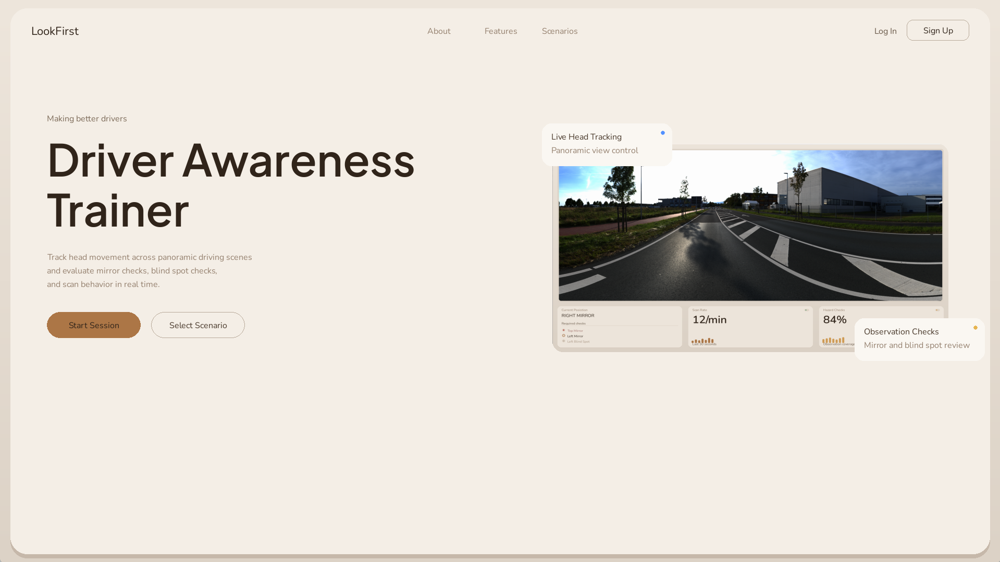
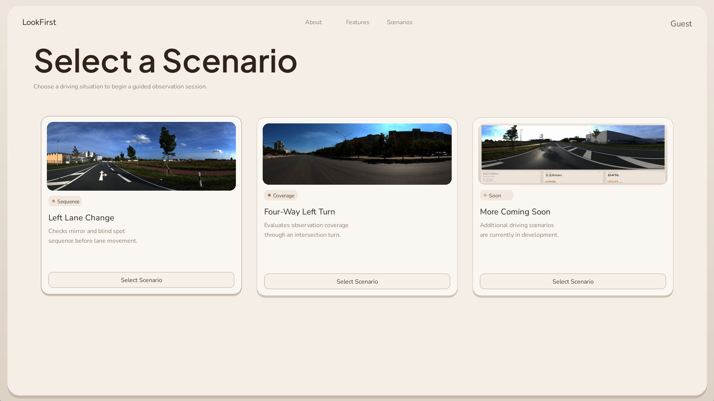
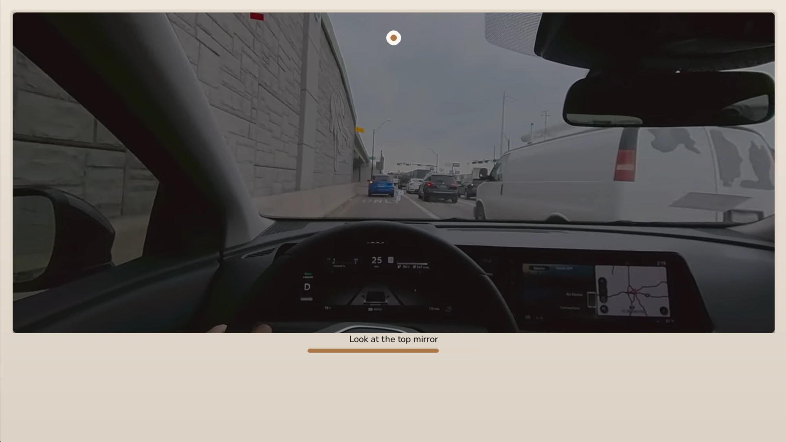
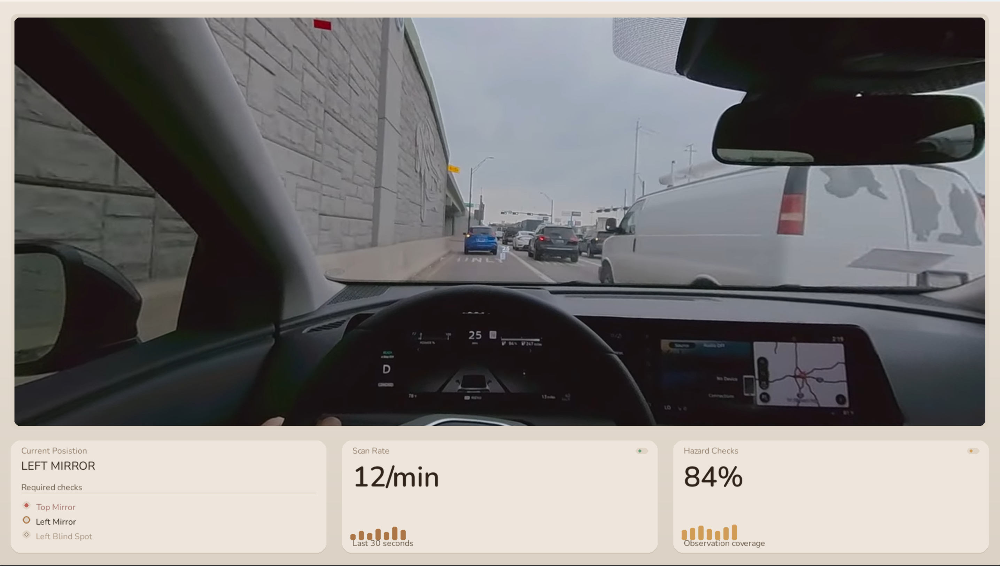
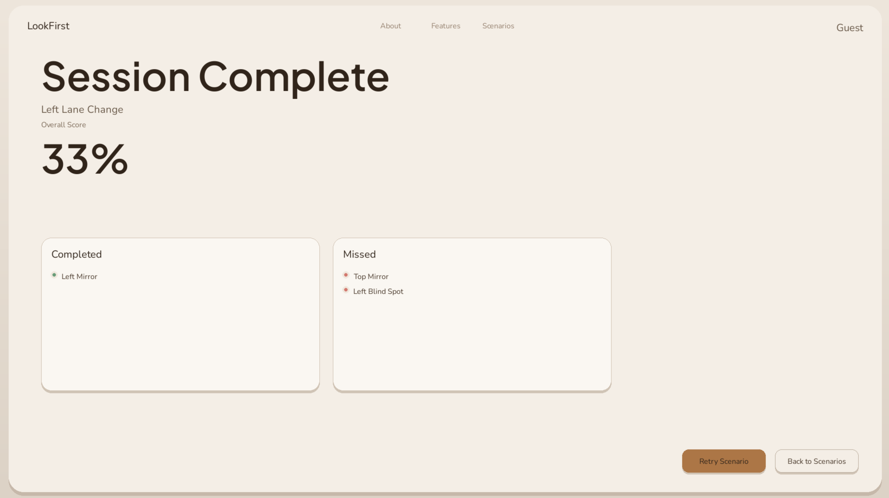

# LookFirst

A driver's-test prep tool that uses your webcam to check whether you actually look before you move.

## What it does

LookFirst tracks your head pose and eye gaze with MediaPipe and works out which part of the driving scene you are looking at: forward, left/right mirror, left/right blind spot, top (rear-view) mirror, or down. It plays you through a panoramic driving scenario and scores whether you made the required observation checks, and in the right order where order matters.

- **Head + gaze fusion:** head turns alone don't count for mirror checks. Your eyes have to move too, so a lazy "turn the head, stare ahead" check is caught.
- **Per-user calibration:** a short guided routine (look forward, look at each zone, move your head while holding your gaze) fits the tracking to your face and camera.
- **Scenarios:** *Left Lane Change* (ordered sequence of checks) and *Four-Way Left Turn* (coverage of the intersection).
- **Results:** an overall score with the checks you completed and the ones you missed.
- **Accounts (optional):** a FastAPI + Postgres backend stores accounts and session history. Without it, use guest mode.

## Screenshots

| | |
|---|---|
|  **Home** |  **Pick a scenario** |
|  **Calibration:** look at each target |  **Simulation:** live gaze zone and required checks |
|  **Results:** score, completed and missed checks |  **Sign up / sign in**, or continue as guest |

## Run it yourself

You need Python 3 and a working webcam. The two halves are independent and each has its own virtual environment. The commands below are for Windows; on macOS/Linux use `source <env>/bin/activate` instead of the `Scripts\activate` line.

### Simulator (required)

```
python -m venv drivesim_env
drivesim_env\Scripts\activate
pip install -r requirements.txt
python sim/mainlogic.py
```

Choose **Continue as Guest** on the sign-up screen to use it without a backend.

To log in and save sessions, copy `sim/api_config.json.example` to `sim/api_config.json` and set your backend URL. If the file is missing, the sim uses `http://127.0.0.1:8000`.

### Backend (optional)

Needs a Postgres database. Run from the repo root:

```
python -m venv backend_env
backend_env\Scripts\activate
pip install -r backend/requirements.txt
```

Copy `backend/.env.example` to `backend/.env` and fill it in. `DATABASE_URL` and `SECRET_KEY` are required; `ANTHROPIC_API_KEY` is only needed for AI coaching reports. Then start the API:

```
uvicorn backend.main:app --reload
```

## Project layout

- `sim/` – pygame desktop client: webcam tracking, calibration, scenarios and UI
- `backend/` – FastAPI API for auth and session/gaze history
- `docs/screenshots/` – images used in this README
